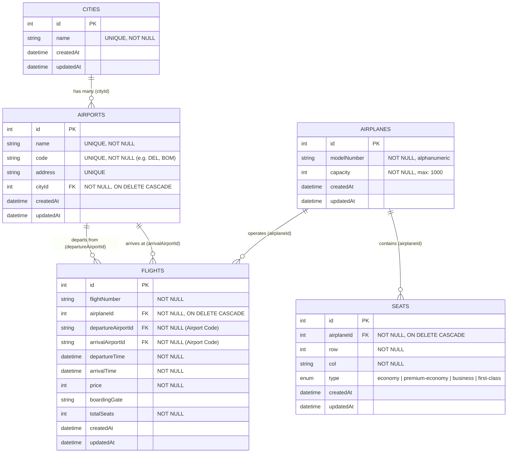

# ✈️ Airline Booking System - Flight Service

[](https://nodejs.org/)
[](https://expressjs.com/)
[](https://sequelize.org/)
[](https://www.mysql.com/)
[](#license)

A production-grade, highly scalable **Flight Service** microservice built for an end-to-end **Airline Booking System**. This service manages airplanes, cities, airports, flights, and seat inventories, providing robust CRUD capabilities, complex search and filtering, and **concurrency-safe seat reservation handling using database row-level locking**.

---

## 📑 Table of Contents

- [Overview & Architecture](#-overview--architecture)
  - [Architectural Layers](#architectural-layers)
  - [Key Architectural Highlights](#key-architectural-highlights)
- [Database Schema & ER Diagram](#-database-schema--er-diagram)
  - [Entity-Relationship Diagram](#entity-relationship-diagram)
  - [Models & Relations Overview](#models--relations-overview)
- [Key Engineering Highlights](#-key-engineering-highlights)
  - [Pessimistic Concurrency Control (Row Locking)](#1-pessimistic-concurrency-control-row-locking)
  - [Advanced Dynamic Flight Filtering](#2-advanced-dynamic-flight-filtering)
  - [Unified API Response Standard](#3-unified-api-response-standard)
  - [Centralized Logging with Winston](#4-centralized-logging-with-winston)
- [API Documentation](#-api-documentation)
  - [System Health](#system-health)
  - [Airplanes API](#airplanes-api)
  - [Cities API](#cities-api)
  - [Airports API](#airports-api)
  - [Flights API](#flights-api)
- [Folder Structure](#-folder-structure)
- [Getting Started & Installation](#-getting-started--installation)
  - [Prerequisites](#prerequisites)
  - [1. Clone Repository & Install Dependencies](#1-clone-repository--install-dependencies)
  - [2. Configure Environment & Database](#2-configure-environment--database)
  - [3. Database Initialization, Migrations & Seeders](#3-database-initialization-migrations--seeders)
  - [4. Start the Application](#4-start-the-application)
- [Testing the APIs with cURL](#-testing-the-apis-with-curl)
- [Troubleshooting & FAQs](#-troubleshooting--faqs)

---

## 🏛 Overview & Architecture

The **Flight Service** is developed following the **Clean Layered Architecture (Separation of Concerns)** pattern. It decouples business rules from protocol layers and persistence layers, ensuring high maintainability, testability, and scalability.

```
Incoming Request
      │
      ▼
┌───────────────┐
│ Express Route │ ──> URL routing & HTTP verb mapping
└───────┬───────┘
        │
        ▼
┌───────────────┐
│  Middlewares  │ ──> Request schema validation & input checks
└───────┬───────┘
        │
        ▼
┌───────────────┐
│  Controllers  │ ──> Unpack HTTP requests, delegate to service, format response
└───────┬───────┘
        │
        ▼
┌───────────────┐
│   Services    │ ──> Core business logic, timestamp comparisons, domain validation
└───────┬───────┘
        │
        ▼
┌───────────────┐
│ Repositories  │ ──> Data access layer (Sequelize ORM & raw queries)
└───────┬───────┘
        │
        ▼
┌───────────────┐
│ MySQL Database│ ──> Relational persistence & transactions
└───────────────┘
```

### Architectural Layers

1. **Routes (`src/routes/`)**: Registers endpoints under `/api/v1/...` and chains validation middlewares before controller execution.
2. **Middlewares (`src/middlewares/`)**: Intercepts requests to validate required payload parameters (e.g. `flightNumber`, `airplaneId`, `code`, `cityId`), failing early with `400 Bad Request` if invalid.
3. **Controllers (`src/controllers/`)**: Acts as the HTTP interface layer. Receives data from requests, triggers business actions in the service layer, and shapes the output into standardized `SuccessResponse` or `ErrorResponse` objects.
4. **Services (`src/services/`)**: Enforces business invariants (e.g., verifying `departureTime < arrivalTime`), parses query strings into complex database filters, and formats validation errors.
5. **Repositories (`src/repositories/`)**:
   - `CrudRepository`: A generic base repository implementing reusable CRUD primitives (`create`, `get`, `getAll`, `update`, `destroy`).
   - Domain Repositories: Extends `CrudRepository` with domain-specific queries, eager loading, transactions, and row-level locks.
6. **Models (`src/models/`)**: Defines Sequelize entities with data types, table constraints, validations, and relational associations.
7. **Utils & Config (`src/utils/`, `src/config/`)**: Reusable helper functions, custom `AppError` class, response envelopes, Winston logger, and environment loader.

---

## 🗄 Database Schema & ER Diagram

### Entity-Relationship Diagram



### Models & Relations Overview

- **City (`Cities`)**: Represents a metropolitan area hosting one or more airports. Cascade deletes linked airports upon removal.
- **Airport (`Airports`)**: Has a unique IATA-style code (e.g., `DEL`, `BOM`, `BLR`), unique name, and reference to its host city.
- **Airplane (`Airplanes`)**: Holds the aircraft model (e.g., `boeing777`, `airbus340`) and maximum passenger capacity.
- **Flight (`Flights`)**: Connects an airplane with a departure and arrival airport along with timing, pricing, boarding gate, and current available seat count.
- **Seat (`Seats`)**: Maps physical seat coordinates (`row`, `col`) inside a specific airplane with categorized classes (`economy`, `premium-economy`, `business`, `first-class`).

---

## 💡 Key Engineering Highlights

### 1. Pessimistic Concurrency Control (Row Locking)
When high-traffic booking events occur simultaneously, multiple users or booking services might attempt to book the last available seats at the exact same instant, leading to race conditions and overselling.

The flight service implements **Pessimistic Concurrency Control** in `FlightRepository.updateRemainingSeats()`:
```javascript
// 1. Begin Database Transaction
const transaction = await db.sequelize.transaction();
try {
    // 2. Acquire Exclusive Row-Level Lock
    await db.sequelize.query(`SELECT * from Flights WHERE Flights.id = ${flightId} FOR UPDATE;`);
    
    // 3. Perform Concurrency-Safe Mutation
    const flight = await Flight.findByPk(flightId);
    if (+dec) {
        await flight.decrement('totalSeats', { by: seats }, { transaction: transaction });
    } else {
        await flight.increment('totalSeats', { by: seats }, { transaction: transaction });
    }
    
    // 4. Commit Transaction and Release Lock
    await transaction.commit();
    return flight;
} catch (error) {
    await transaction.rollback();
    throw error;
}
```

### 2. Advanced Dynamic Flight Filtering
The `GET /api/v1/flights` endpoint supports dynamic, composable query parameters with eager-loaded relational associations:
- **Route Filtering (`trips=DEL-BOM`)**: Searches flights by departure and arrival airport codes, automatically joining both `Airport` models and their respective `City` models.
- **Price Range (`price=1000-5000`)**: Evaluates `Op.between` bounds.
- **Passenger Count (`travellers=2`)**: Filters flights with `totalSeats >= travellers` using `Op.gte`.
- **Date Matching (`tripDate=2026-10-30`)**: Matches flights departing between `2026-10-30 00:00:00` and `2026-10-30 23:59:00`.
- **Multi-Column Sorting (`sort=price_asc,departureTime_desc`)**: Parses comma-separated field and order directives into Sequelize order tuples.

### 3. Unified API Response Standard
Every API endpoint responds with a consistent envelope for seamless frontend and microservice consumption:

#### Success Response Envelope (`2xx`)
```json
{
  "success": true,
  "message": "Successfully completed the request",
  "data": { ... },
  "error": {}
}
```

#### Error Response Envelope (`4xx / 5xx`)
```json
{
  "success": false,
  "message": "Something went wrong",
  "data": {},
  "error": {
    "statusCode": 400,
    "explanation": [
      "departureAirportId not found in the incoming request in correct form"
    ]
  }
}
```

### 4. Centralized Logging with Winston
System events and errors are formatted with timestamps and output both to the interactive terminal and written persistently to `combined.log` for debugging and audit trails.

---

## 📡 API Documentation

Base URL: `http://localhost:3000/api/v1`

### System Health

#### Check Service Status
```http
GET /api/v1/info
```
**Response (`200 OK`)**:
```json
{
  "success": true,
  "message": "API is live",
  "error": {},
  "data": {}
}
```

---

### Airplanes API

| Method | Endpoint | Description |
| :--- | :--- | :--- |
| `POST` | `/api/v1/airplanes` | Create a new airplane |
| `GET` | `/api/v1/airplanes` | Fetch all airplanes |
| `GET` | `/api/v1/airplanes/:id` | Fetch single airplane by ID |
| `PATCH` | `/api/v1/airplanes/:id` | Update airplane details |
| `DELETE` | `/api/v1/airplanes/:id` | Delete an airplane |

#### 1. Create Airplane
- **Endpoint**: `POST /api/v1/airplanes`
- **Request Body**:
```json
{
  "modelNumber": "boeing777",
  "capacity": 350
}
```
- **Response (`201 Created`)**:
```json
{
  "success": true,
  "message": "Successfully created an Airplane",
  "data": {
    "id": 1,
    "modelNumber": "boeing777",
    "capacity": 350,
    "updatedAt": "2026-10-26T05:30:00.000Z",
    "createdAt": "2026-10-26T05:30:00.000Z"
  },
  "error": {}
}
```

#### 2. Get All Airplanes
- **Endpoint**: `GET /api/v1/airplanes`

#### 3. Get Airplane by ID
- **Endpoint**: `GET /api/v1/airplanes/:id`

#### 4. Update Airplane
- **Endpoint**: `PATCH /api/v1/airplanes/:id`
- **Request Body**:
```json
{
  "capacity": 400
}
```

#### 5. Delete Airplane
- **Endpoint**: `DELETE /api/v1/airplanes/:id`

---

### Cities API

| Method | Endpoint | Description |
| :--- | :--- | :--- |
| `POST` | `/api/v1/cities` | Create a new city |
| `PATCH` | `/api/v1/cities/:id` | Update an existing city |
| `DELETE` | `/api/v1/cities/:id` | Delete a city (Cascades to Airports) |

#### 1. Create City
- **Endpoint**: `POST /api/v1/cities`
- **Request Body**:
```json
{
  "name": "Mumbai"
}
```
- **Response (`201 Created`)**:
```json
{
  "success": true,
  "message": "Successfully created a City",
  "data": {
    "id": 1,
    "name": "Mumbai",
    "updatedAt": "2026-10-26T05:30:00.000Z",
    "createdAt": "2026-10-26T05:30:00.000Z"
  },
  "error": {}
}
```

#### 2. Update City
- **Endpoint**: `PATCH /api/v1/cities/:id`
- **Request Body**:
```json
{
  "name": "Bombay"
}
```

#### 3. Delete City
- **Endpoint**: `DELETE /api/v1/cities/:id`

---

### Airports API

| Method | Endpoint | Description |
| :--- | :--- | :--- |
| `POST` | `/api/v1/airports` | Register a new airport |
| `GET` | `/api/v1/airports` | Get list of all registered airports |
| `GET` | `/api/v1/airports/:id` | Get airport by ID |
| `PATCH` | `/api/v1/airports/:id` | Update airport details |
| `DELETE` | `/api/v1/airports/:id` | Delete an airport |

#### 1. Create Airport
- **Endpoint**: `POST /api/v1/airports`
- **Request Body**:
```json
{
  "name": "Chhatrapati Shivaji Maharaj International Airport",
  "code": "BOM",
  "address": "Sahar, Andheri East, Mumbai",
  "cityId": 1
}
```
- **Response (`201 Created`)**:
```json
{
  "success": true,
  "message": "Successfully created an Airplane",
  "data": {
    "id": 1,
    "name": "Chhatrapati Shivaji Maharaj International Airport",
    "code": "BOM",
    "address": "Sahar, Andheri East, Mumbai",
    "cityId": 1,
    "updatedAt": "2026-10-26T05:30:00.000Z",
    "createdAt": "2026-10-26T05:30:00.000Z"
  },
  "error": {}
}
```

---

### Flights API

| Method | Endpoint | Description |
| :--- | :--- | :--- |
| `POST` | `/api/v1/flights` | Schedule a new flight |
| `GET` | `/api/v1/flights` | Search flights with multi-criteria filters |
| `GET` | `/api/v1/flights/:id` | Get single flight details |
| `PATCH` | `/api/v1/flights/:id/seats` | Concurrency-safe seat reservation / cancellation |

#### 1. Create Flight
- **Endpoint**: `POST /api/v1/flights`
- **Request Body**:
```json
{
  "flightNumber": "AI 202",
  "airplaneId": 1,
  "departureAirportId": "BOM",
  "arrivalAirportId": "DEL",
  "departureTime": "2026-11-01 10:00:00",
  "arrivalTime": "2026-11-01 12:15:00",
  "price": 4500,
  "boardingGate": "4B",
  "totalSeats": 180
}
```
> **Validation Rule**: `departureTime` must be earlier than `arrivalTime`.

#### 2. Search / Filter Flights
- **Endpoint**: `GET /api/v1/flights`
- **Query Parameters**:
  - `trips`: Route formatted as `[departureCode]-[arrivalCode]` (e.g. `BOM-DEL`)
  - `price`: Range formatted as `[min]-[max]` (e.g. `3000-8000`)
  - `travellers`: Minimum remaining seats required (e.g. `2`)
  - `tripDate`: Departure date in `YYYY-MM-DD` (e.g. `2026-11-01`)
  - `sort`: Comma-separated sort attributes (e.g. `price_asc,departureTime_desc`)

**Example Request**:
```http
GET /api/v1/flights?trips=BOM-DEL&price=2000-6000&travellers=2&tripDate=2026-11-01&sort=price_asc
```

#### 3. Get Flight by ID
- **Endpoint**: `GET /api/v1/flights/:id`

#### 4. Update Remaining Seats (Book / Cancel Seats)
- **Endpoint**: `PATCH /api/v1/flights/:id/seats`
- **Request Body**:
```json
{
  "seats": 2,
  "dec": 1
}
```
> - `dec: 1` or `true`: Decrements available seats (used during booking).
> - `dec: 0` or `false`: Increments available seats (used during cancellation).
> - This operation runs inside a row-locked transaction (`FOR UPDATE`).

---

## 📂 Folder Structure

```
Flight-service/
├── .env                              # Environment variables file
├── .gitignore                        # Git ignore patterns
├── combined.log                      # Winston persistent log file
├── package.json                      # Project metadata & npm dependencies
├── README.md                         # Comprehensive project documentation
└── src/
    ├── index.js                      # Application entry point & server bootstrap
    ├── config/
    │   ├── config.json               # Sequelize database configuration (dev/test/prod)
    │   ├── index.js                  # Central configuration exporter
    │   ├── logger-config.js          # Winston logger instance & formatters
    │   └── server-config.js          # Dotenv configuration loader
    ├── controllers/
    │   ├── airplane-controller.js    # Airplane HTTP request handlers
    │   ├── airport-controller.js     # Airport HTTP request handlers
    │   ├── city-controller.js        # City HTTP request handlers
    │   ├── flight-controller.js      # Flight HTTP request handlers
    │   ├── index.js                  # Controller module aggregator
    │   └── info-controller.js        # Health check controller
    ├── middlewares/
    │   ├── airplane-middlewares.js   # Validation middleware for airplane requests
    │   ├── airport-middlewares.js    # Validation middleware for airport requests
    │   ├── city-middleware.js        # Validation middleware for city requests
    │   ├── flight-middlewares.js     # Validation middleware for flight & seat requests
    │   └── index.js                  # Middleware module aggregator
    ├── migrations/
    │   ├── 20260221185047-create-airplane.js
    │   ├── 20260227085117-create-city.js
    │   ├── 20260303110954-create-airport.js
    │   ├── 20260306090241-update--city-airplane-association.js
    │   ├── 20260307094403-create-flight.js
    │   └── 20260312095532-create-seat.js
    ├── models/
    │   ├── airplane.js               # Airplane Sequelize model & associations
    │   ├── airport.js                # Airport Sequelize model & associations
    │   ├── city.js                   # City Sequelize model & associations
    │   ├── flight.js                 # Flight Sequelize model & associations
    │   ├── index.js                  # Sequelize initialization & model loader
    │   └── seat.js                   # Seat Sequelize model with Enum types
    ├── repositories/
    │   ├── airplane-repositories.js  # Airplane data layer
    │   ├── airport-repository.js     # Airport data layer
    │   ├── city-repositories.js      # City data layer
    │   ├── crud-repositories.js      # Reusable generic CRUD base class
    │   ├── flight-repositories.js    # Flight data layer with joins & row locking
    │   ├── index.js                  # Repository aggregator
    │   └── queries.js                # Raw SQL queries (pessimistic locking)
    ├── routes/
    │   ├── index.js                  # Master router (/api)
    │   └── v1/
    │       ├── airplane-routes.js    # /api/v1/airplanes
    │       ├── airport-routes.js     # /api/v1/airports
    │       ├── city-routes.js        # /api/v1/cities
    │       ├── flight-routes.js      # /api/v1/flights
    │       └── index.js              # Aggregated v1 router
    ├── seeders/
    │   ├── 20260224105124-add-airplanes.js # Sample aircraft seed data
    │   └── 20260312111349-add-seats.js     # Sample airplane seats seed data
    ├── services/
    │   ├── airplane-service.js       # Airplane business logic
    │   ├── airport-service.js        # Airport business logic
    │   ├── city-service.js           # City business logic
    │   ├── flight-service.js         # Flight search & seat allocation logic
    │   └── index.js                  # Service module aggregator
    └── utils/
        ├── common/
        │   ├── enums.js              # System enums (e.g. SEAT_TYPES)
        │   ├── error-response.js     # Standard error JSON structure
        │   ├── index.js              # Common utils aggregator
        │   └── success-response.js   # Standard success JSON structure
        ├── errors/
        │   └── app-error.js          # Custom Application Error class
        └── helpers/
            └── datetime-helper.js    # Date and timestamp comparison helpers
```

---

## 🚀 Getting Started & Installation

### Prerequisites

Ensure you have the following installed on your machine:
- [Node.js](https://nodejs.org/) (v18.x or later)
- [npm](https://www.npmjs.com/) (v9.x or later)
- [MySQL Server](https://dev.mysql.com/downloads/installer/) (v8.0 or later)

---

### 1. Clone Repository & Install Dependencies

```bash
# Clone the repository
git clone https://github.com/Darshbhesaniya/Flight-Service.git

# Navigate into the project directory
cd Flight-service

# Install all npm dependencies
npm install
```

---

### 2. Configure Environment & Database

#### 2.1 Set up `.env`
Create or modify the `.env` file in the root directory:
```env
PORT=3000
```

#### 2.2 Configure Database Credentials
Edit `src/config/config.json` to match your local MySQL configuration:
```json
{
  "development": {
    "username": "root",
    "password": "your_mysql_password",
    "database": "Flights",
    "host": "127.0.0.1",
    "dialect": "mysql"
  }
}
```

---

### 3. Database Initialization, Migrations & Seeders

Run the Sequelize CLI commands to create the database schema and populate initial data:

```bash
# 1. Create the database
npx sequelize-cli db:create

# 2. Run all migrations to create tables and foreign keys
npx sequelize-cli db:migrate

# 3. (Optional) Run seeders to populate initial airplanes and seats
npx sequelize-cli db:seed:all
```

> **Tip**: To execute a specific seed file individually:
> ```bash
> npx sequelize-cli db:seed --seed 20260224105124-add-airplanes.js
> npx sequelize-cli db:seed --seed 20260312111349-add-seats.js
> ```

---

### 4. Start the Application

#### Development Mode (with automatic restart via nodemon)
```bash
npm start
```

Once started, you will see:
```
Server Started Succesfully on PORT : 3000
```

You can verify the server by visiting `http://localhost:3000/api/v1/info` in your browser.

---

## 🧪 Testing the APIs with cURL

Here is an end-to-end testing workflow:

### 1. Health Check
```bash
curl -X GET http://localhost:3000/api/v1/info
```

### 2. Create an Airplane
```bash
curl -X POST http://localhost:3000/api/v1/airplanes \
  -H "Content-Type: application/json" \
  -d "{\"modelNumber\": \"airbus320\", \"capacity\": 180}"
```

### 3. Create a City
```bash
curl -X POST http://localhost:3000/api/v1/cities \
  -H "Content-Type: application/json" \
  -d "{\"name\": \"Delhi\"}"
```

### 4. Create an Airport
```bash
curl -X POST http://localhost:3000/api/v1/airports \
  -H "Content-Type: application/json" \
  -d "{\"name\": \"Indira Gandhi International Airport\", \"code\": \"DEL\", \"address\": \"Palam, New Delhi\", \"cityId\": 1}"
```

### 5. Schedule a Flight
```bash
curl -X POST http://localhost:3000/api/v1/flights \
  -H "Content-Type: application/json" \
  -d "{
    \"flightNumber\": \"6E 2024\",
    \"airplaneId\": 1,
    \"departureAirportId\": \"DEL\",
    \"arrivalAirportId\": \"BOM\",
    \"departureTime\": \"2026-11-15 08:00:00\",
    \"arrivalTime\": \"2026-11-15 10:15:00\",
    \"price\": 4200,
    \"boardingGate\": \"2A\",
    \"totalSeats\": 180
  }"
```

### 6. Search Flights (Filter by Route, Price, and Date)
```bash
curl -X GET "http://localhost:3000/api/v1/flights?trips=DEL-BOM&price=2000-6000&travellers=1&sort=price_asc"
```

### 7. Reserve Seats (Pessimistic Lock Demo)
```bash
curl -X PATCH http://localhost:3000/api/v1/flights/1/seats \
  -H "Content-Type: application/json" \
  -d "{\"seats\": 2, \"dec\": 1}"
```

---

## 🛠 Troubleshooting & FAQs

### Q1: `Access denied for user 'root'@'localhost'`
- **Fix**: Update the `password` field in `src/config/config.json` with your MySQL root password.

### Q2: `Unknown database 'Flights'`
- **Fix**: Run `npx sequelize-cli db:create` before running migrations, or manually create the database using MySQL workbench / CLI:
  ```sql
  CREATE DATABASE Flights;
  ```

### Q3: `Cannot add or update a child row: a foreign key constraint fails`
- **Fix**: When creating an Airport, ensure that the referenced `cityId` exists in the `Cities` table. Similarly, when scheduling a Flight, verify that `airplaneId`, `departureAirportId`, and `arrivalAirportId` exist.

### Q4: `Departure time not be greater than arrival time`
- **Fix**: Ensure that the flight's `departureTime` timestamp occurs strictly before `arrivalTime`.

---

## 👨‍💻 Author

**Darsh Bhesaniya**  
- GitHub: [@Darshbhesaniya](https://github.com/Darshbhesaniya)

---
